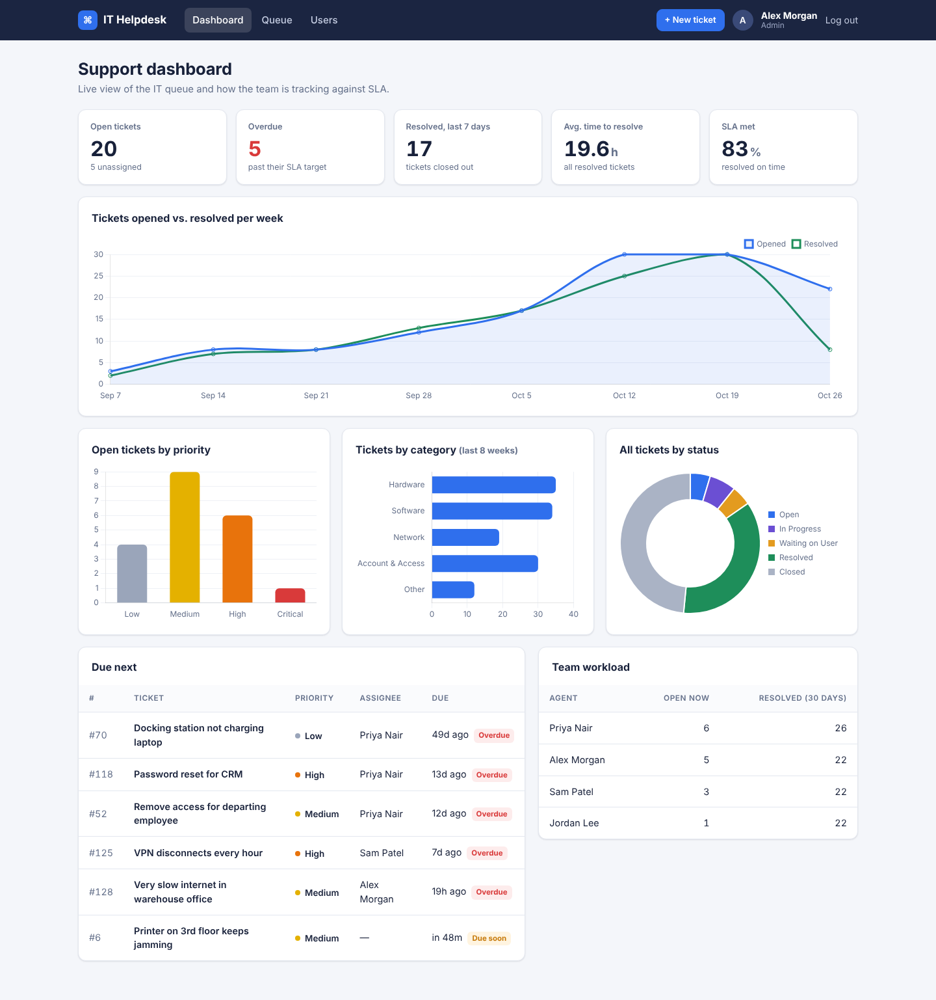
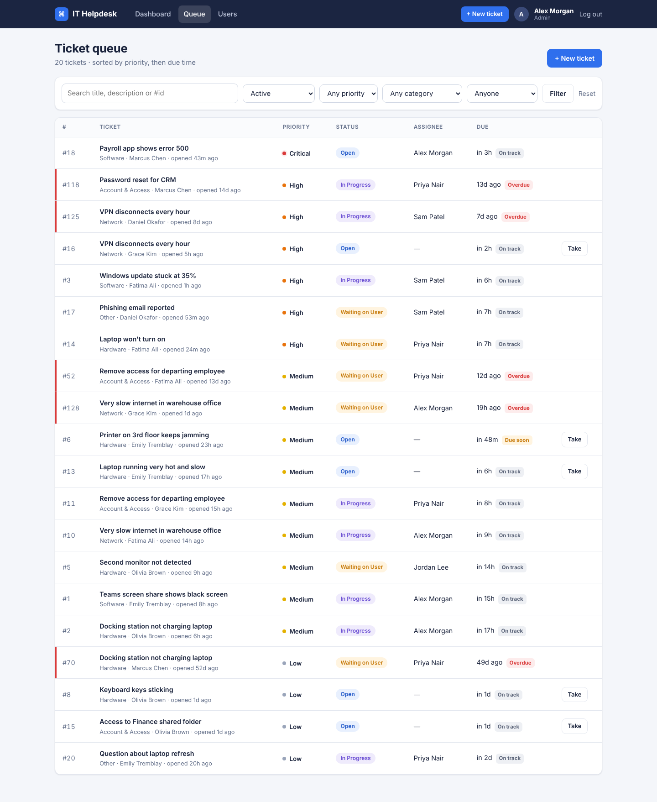
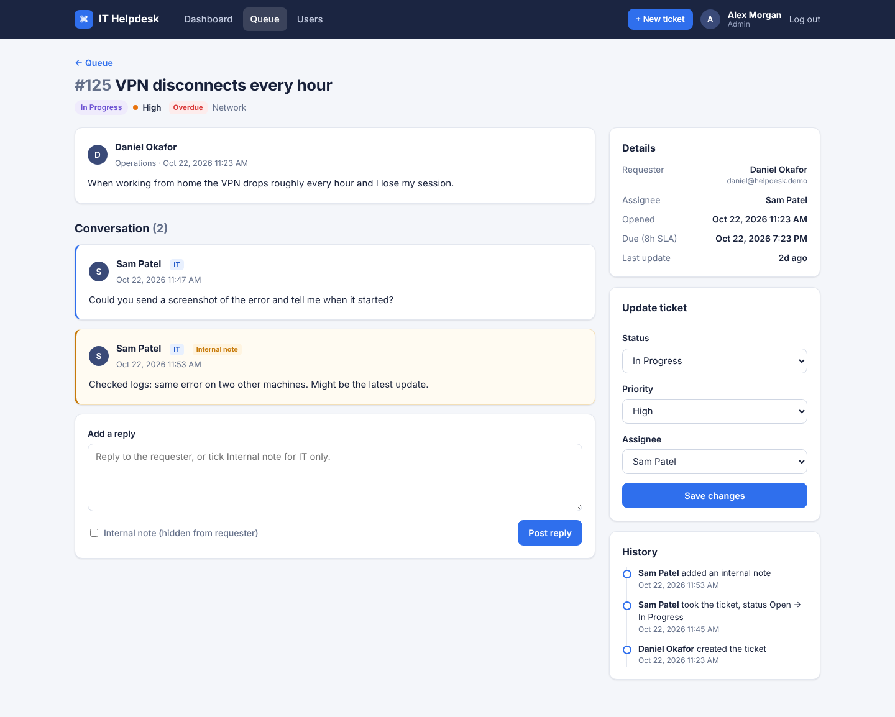
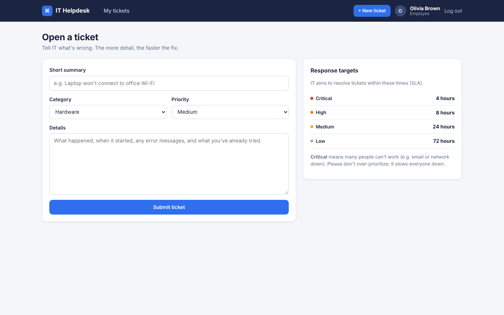
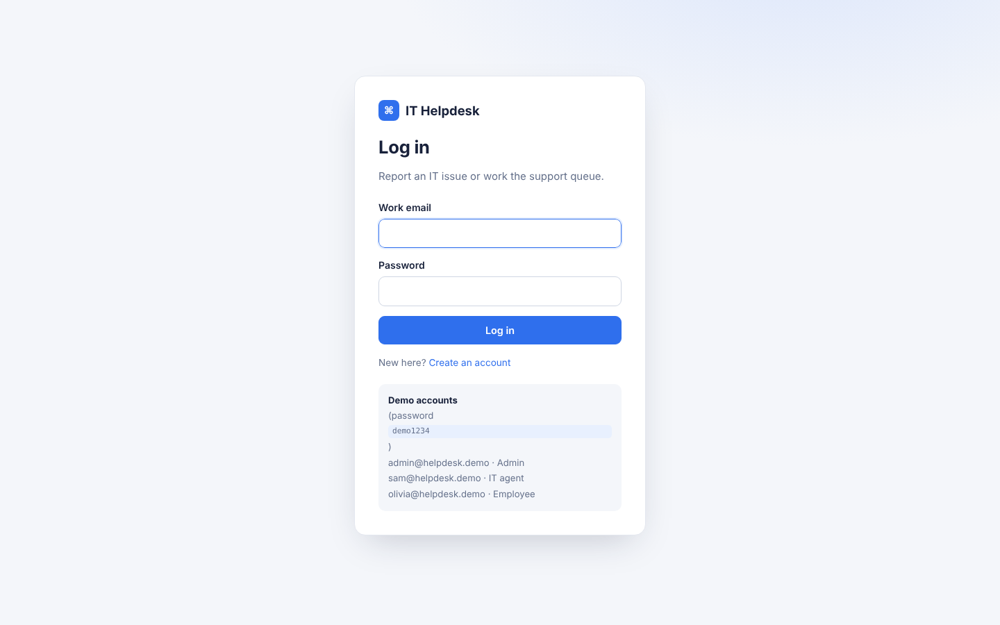
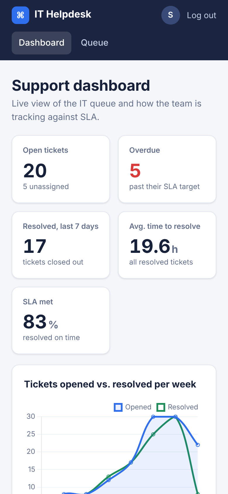

# IT Helpdesk – Ticketing System

A web app for an office IT team: **employees report IT problems, IT agents work the queue, and managers watch a live dashboard** of workload and SLA performance.

Built with **Python, Flask and SQLite**, with role-based access, SLA tracking, an audit trail and 14 automated tests.



## Features

**For employees**
- Open a ticket with a category (Hardware, Software, Network, Account & Access, Other) and priority
- See only their own tickets, reply to IT, and get a clear status on each one

**For IT agents**
- A queue sorted by priority, then due time, with filters (status, priority, category, assignee) and search
- One-click **Take** to claim unassigned tickets
- Change status, priority and assignee; post replies or **internal notes** the requester can't see
- Every change is written to the ticket's **history** (who did what, and when)

**For admins**
- Everything agents can do, plus a **Users & roles** page to promote employees to agents

**SLA tracking**

| Priority | Target to resolve |
|---|---|
| Critical | 4 hours |
| High | 8 hours |
| Medium | 24 hours |
| Low | 72 hours |

Each ticket gets a due time when it's created. It is re-calculated if the priority changes. Tickets are flagged **On track**, **Due soon**, **Overdue**, **SLA met** or **SLA missed**.

**Dashboard (agents and admins)**
- KPIs: open tickets, unassigned, overdue, resolved in the last 7 days, average time to resolve, % resolved within SLA
- Charts: opened vs. resolved per week, open tickets by priority, tickets by category, all tickets by status
- "Due next" list and team workload table

## Screenshots

| Ticket queue | Ticket detail |
|---|---|
|  |  |

| Employee: open a ticket | Login | Mobile |
|---|---|---|
|  |  |  |

## Security

- Passwords hashed with Werkzeug (`generate_password_hash`), never stored in plain text
- Role checks on every route (`login_required`, `role_required`). Employees get **403** on other people's tickets, the dashboard and admin pages
- CSRF token on every form
- All SQL uses parameterized queries (search is safe from SQL injection)
- Login redirect only allows local paths (no open redirect)
- Session cookie is `HttpOnly` and `SameSite=Lax`; security headers (`X-Frame-Options`, `X-Content-Type-Options`, `Referrer-Policy`)
- Internal notes are filtered out in the SQL query for employees, not just hidden in the page

## Run it locally

```bash
git clone https://github.com/bzayed888/it-helpdesk.git
cd it-helpdesk
python -m venv venv
venv\Scripts\activate          # Windows  (macOS/Linux: source venv/bin/activate)
pip install -r requirements.txt
python seed.py                 # creates helpdesk.db with demo users and 130 tickets
flask --app app run
```

Open http://127.0.0.1:5000 and log in with a demo account (password **demo1234**):

| Email | Role |
|---|---|
| admin@helpdesk.demo | Admin |
| sam@helpdesk.demo | IT agent |
| olivia@helpdesk.demo | Employee |

To start with an empty database instead: `flask --app app init-db`.

## Tests

```bash
pip install -r requirements-dev.txt
python -m pytest
```

The 14 tests cover login and CSRF, access control between employees, agents and admins, SLA due times, status changes and history, internal-note privacy, SQL-injection-safe search and open-redirect protection.

## Project structure

```
app.py            Routes, roles, SLA logic, dashboard queries
db.py             SQLite connection helpers
schema.sql        Tables: users, tickets, comments, activity (with CHECK constraints + indexes)
seed.py           Demo data generator
templates/        Jinja2 pages (queue, ticket, dashboard, users, auth)
static/           CSS, dashboard charts (Chart.js, bundled locally)
tests/            pytest suite
```

## Database design

- **users**: name, email, department, role (`employee`, `agent` or `admin`), password hash
- **tickets**: title, description, category, priority, status, requester, assignee, created/updated/due/resolved times
- **comments**: replies and internal notes on a ticket
- **activity**: audit log of every change to a ticket

## Author

**Basil Zayed** · Technology Management (IT), Ontario Tech University
[LinkedIn](https://www.linkedin.com/in/basil-zayed-0aab61336/) · [GitHub](https://github.com/bzayed888)
